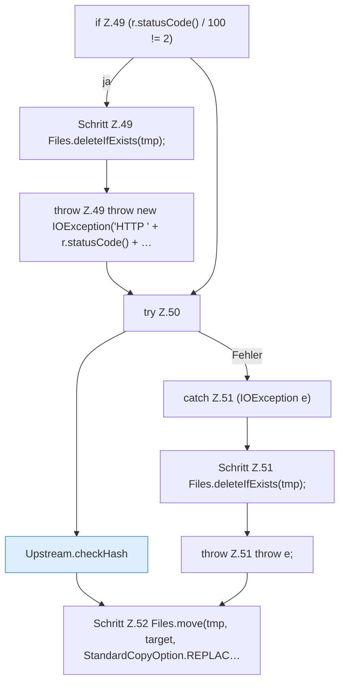

[[00 Start]] › [[Server-Anlage]] › [[Versionen]] › [[Upstream]] › [[Upstream.download(String,Path,String,String)]]

# Upstream.download(String,Path,String,String)

`Upstream.download(String url, Path target, String algo, String expectedHex)` [src/main/java/de/aichele/childlauncher/Upstream.java:45–53](https://github.com/Sciddie/minecraft-serverhoster-plugin/blob/95b02b953b0b4c23673e900e021a7c3c844aa37d/src/main/java/de/aichele/childlauncher/Upstream.java#L45-L53)



```knoten
if Z.49 (r.statusCode() / 100 != 2)
  Zeile 49: prüft `(r.statusCode() / 100 != 2)`.
Schritt Z.49 Files.deleteIfExists(tmp);
  Zeile 49: Dateioperation. `Files.deleteIfExists(tmp);`
throw Z.49 throw new IOException('HTTP ' + r.statusCode() + …
  Zeile 49: Abbruch `throw new IOException('HTTP ' + r.statusCode() + …`.
try Z.50
  Zeile 50: Versuch. Der Fehlerpfad geht in catch.
Upstream.checkHash
  Dieser Teil prüft hier einen Schritt. Eine Ebene tiefer steht er genauer. Prüft `checkHash`. Ruft `digest`.
catch Z.51 (IOException e)
  Zeile 51: fängt (IOException e).
Schritt Z.51 Files.deleteIfExists(tmp);
  Zeile 51: Dateioperation. `Files.deleteIfExists(tmp);`
throw Z.51 throw e;
  Zeile 51: Abbruch `throw e;`.
Schritt Z.52 Files.move(tmp, target, StandardCopyOption.REPLAC…
  Zeile 52: Dateioperation. `Files.move(tmp, target, StandardCopyOption.REPLAC…`
```

> [!knoten]- Was die Blöcke tun
> - **if Z.49 (r.statusCode() / 100 != 2)**: Zeile 49: prüft `(r.statusCode() / 100 != 2)`.
> - **Schritt Z.49 Files.deleteIfExists(tmp);**: Zeile 49: Dateioperation. `Files.deleteIfExists(tmp);`
> - **throw Z.49 throw new IOException('HTTP ' + r.statusCode() + …**: Zeile 49: Abbruch `throw new IOException('HTTP ' + r.statusCode() + …`.
> - **try Z.50**: Zeile 50: Versuch. Der Fehlerpfad geht in catch.
> - **Upstream.checkHash**: Dieser Teil prüft hier einen Schritt. Eine Ebene tiefer steht er genauer. Prüft `checkHash`. Ruft `digest`.
> - **catch Z.51 (IOException e)**: Zeile 51: fängt (IOException e).
> - **Schritt Z.51 Files.deleteIfExists(tmp);**: Zeile 51: Dateioperation. `Files.deleteIfExists(tmp);`
> - **throw Z.51 throw e;**: Zeile 51: Abbruch `throw e;`.
> - **Schritt Z.52 Files.move(tmp, target, StandardCopyOption.REPLAC…**: Zeile 52: Dateioperation. `Files.move(tmp, target, StandardCopyOption.REPLAC…`

- Dieser Teil holt das.
- `download` in `src/main/java/de/aichele/childlauncher/Upstream.java`
