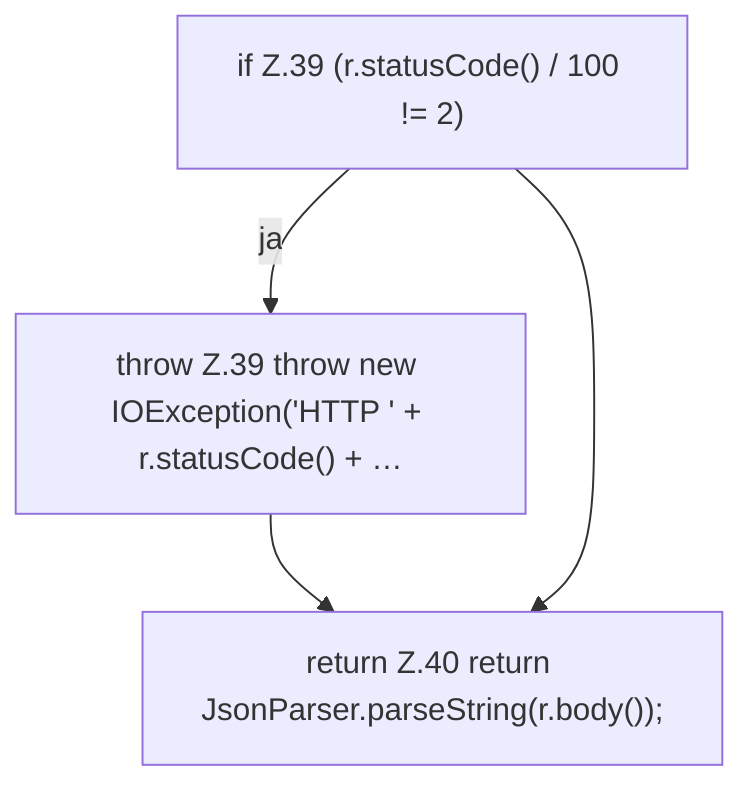

[[00 Start]] › [[Server-Anlage]] › [[Versionen]] › [[Upstream]] › [[Upstream.getJson]]

# Upstream.getJson

`Upstream.getJson(String url)` [src/main/java/de/aichele/childlauncher/Upstream.java:37–41](https://github.com/Sciddie/minecraft-serverhoster-plugin/blob/95b02b953b0b4c23673e900e021a7c3c844aa37d/src/main/java/de/aichele/childlauncher/Upstream.java#L37-L41)



```knoten
if Z.39 (r.statusCode() / 100 != 2)
  Zeile 39: prüft `(r.statusCode() / 100 != 2)`.
throw Z.39 throw new IOException('HTTP ' + r.statusCode() + …
  Zeile 39: Abbruch `throw new IOException('HTTP ' + r.statusCode() + …`.
return Z.40 return JsonParser.parseString(r.body());
  Zeile 40: Rückgabe `return JsonParser.parseString(r.body());`.
```

- `getJson` in `src/main/java/de/aichele/childlauncher/Upstream.java`
