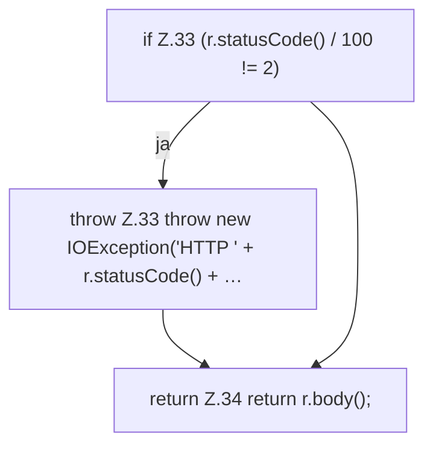

[[00 Start]] › [[Server-Anlage]] › [[Versionen]] › [[Upstream]] › [[Upstream.getText]]

# Upstream.getText

`Upstream.getText(String url)` [src/main/java/de/aichele/childlauncher/Upstream.java:31–35](https://github.com/Sciddie/minecraft-serverhoster-plugin/blob/95b02b953b0b4c23673e900e021a7c3c844aa37d/src/main/java/de/aichele/childlauncher/Upstream.java#L31-L35)

- `getText` in `src/main/java/de/aichele/childlauncher/Upstream.java`
