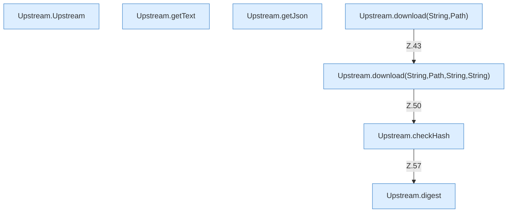

[[00 Start]] › [[Server-Anlage]] › [[Versionen]] › [[Upstream]]

# Upstream



```knoten
Upstream.Upstream
  Dieser Teil macht hier einen einzelnen Schritt. Eine Ebene tiefer steht er genauer. Im [[Glossar#Quelltext|Quelltext]] heißt das `Upstream`.
Upstream.getText
  Dieser Teil liefert den Text. Im [[Glossar#Quelltext|Quelltext]] heißt das `getText`.
Upstream.getJson
  Dieser Teil liefert die Antwort. Im [[Glossar#Quelltext|Quelltext]] heißt das `getJson`.
Upstream.download(String,Path)
  Dieser Teil holt das. Im [[Glossar#Quelltext|Quelltext]] heißt das `download(String,Path)`.
Upstream.download(String,Path,String,String)
  Dieser Teil holt das. Im [[Glossar#Quelltext|Quelltext]] heißt das `download(String,Path,String,String)`.
Upstream.checkHash
  Dieser Teil prüft hier einen Schritt. Eine Ebene tiefer steht er genauer. Im [[Glossar#Quelltext|Quelltext]] heißt das `checkHash`.
Upstream.digest
  Dieser Teil macht hier einen einzelnen Schritt. Eine Ebene tiefer steht er genauer. Im [[Glossar#Quelltext|Quelltext]] heißt das `digest`.
```

> [!knoten]- Was die Blöcke tun
> - **Upstream.Upstream**: Dieser Teil macht hier einen einzelnen Schritt. Eine Ebene tiefer steht er genauer. Im [[Glossar#Quelltext|Quelltext]] heißt das `Upstream`.
> - **Upstream.getText**: Dieser Teil liefert den Text. Im [[Glossar#Quelltext|Quelltext]] heißt das `getText`.
> - **Upstream.getJson**: Dieser Teil liefert die Antwort. Im [[Glossar#Quelltext|Quelltext]] heißt das `getJson`.
> - **Upstream.download(String,Path)**: Dieser Teil holt das. Im [[Glossar#Quelltext|Quelltext]] heißt das `download(String,Path)`.
> - **Upstream.download(String,Path,String,String)**: Dieser Teil holt das. Im [[Glossar#Quelltext|Quelltext]] heißt das `download(String,Path,String,String)`.
> - **Upstream.checkHash**: Dieser Teil prüft hier einen Schritt. Eine Ebene tiefer steht er genauer. Im [[Glossar#Quelltext|Quelltext]] heißt das `checkHash`.
> - **Upstream.digest**: Dieser Teil macht hier einen einzelnen Schritt. Eine Ebene tiefer steht er genauer. Im [[Glossar#Quelltext|Quelltext]] heißt das `digest`.

- Die Quelle im Netz, von der die Versionslisten kommen.
