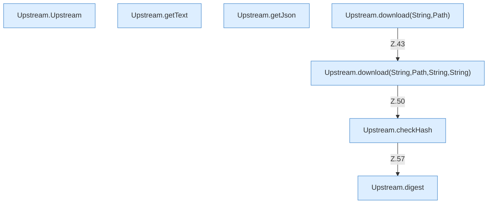

[[00 Start]] › [[Server-Anlage]] › [[Versionen]] › [[Upstream]]

# Upstream



```knoten
Upstream.Upstream
  Holt Daten vom Netz `Upstream`.
Upstream.getText
  Liefert `getText`.
Upstream.getJson
  Liefert `getJson`.
Upstream.download(String,Path)
  Liefert zum Herunterladen `download`. Ruft `download`.
Upstream.download(String,Path,String,String)
  Liefert zum Herunterladen `download`. Ruft `checkHash`.
Upstream.checkHash
  Prüft `checkHash`. Ruft `digest`.
Upstream.digest
  `digest` in `Upstream.java`.
```


