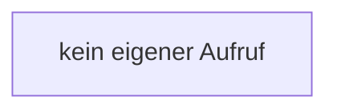

[[00 Start]] › [[Server-Anlage]] › [[Versionen]] › [[VersionCatalog]] › [[VersionCatalog.VersionCatalog]]

# VersionCatalog.VersionCatalog

`VersionCatalog.VersionCatalog()` [src/main/java/de/aichele/childlauncher/VersionCatalog.java:18–18](https://github.com/Sciddie/minecraft-serverhoster-plugin/blob/95b02b953b0b4c23673e900e021a7c3c844aa37d/src/main/java/de/aichele/childlauncher/VersionCatalog.java#L18-L18)



```knoten
kein eigener Aufruf
  In diesem Stück gibt es keinen weiteren eigenen Aufruf.
```

- `VersionCatalog` in `src/main/java/de/aichele/childlauncher/VersionCatalog.java`
