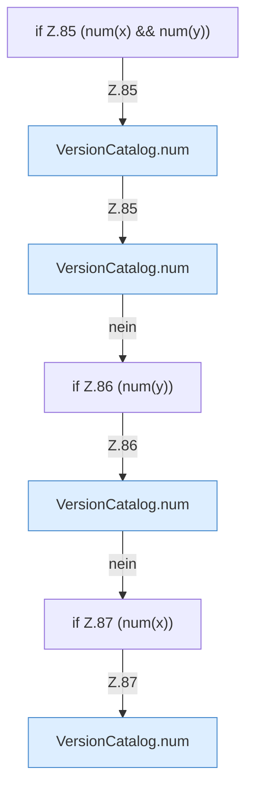

[[00 Start]] › [[Server-Anlage]] › [[Versionen]] › [[VersionCatalog]] › [[VersionCatalog.compare]] › [[VersionCatalog.compare.Z81.Z85]]

# VersionCatalog.compare.Z81.Z85



```knoten
if Z.85 (num(x) && num(y))
  Zeile 85: prüft `(num(x) && num(y))`.
VersionCatalog.num
  `num` in `VersionCatalog.java`.
if Z.86 (num(y))
  Zeile 86: prüft `(num(y))`.
if Z.87 (num(x))
  Zeile 87: prüft `(num(x))`.
```

- Fortsetzung von `VersionCatalog.compare.Z81`, Quellreihenfolge.
