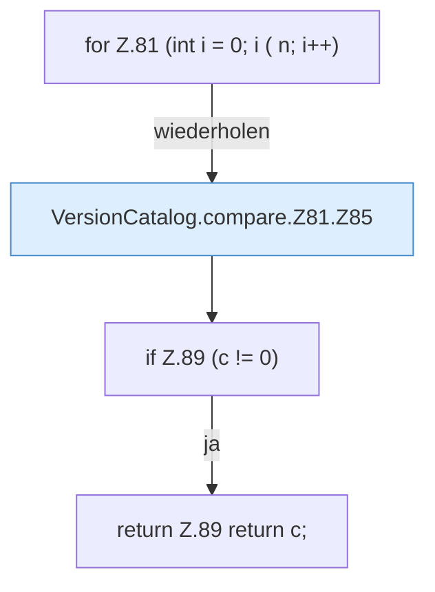

[[00 Start]] › [[Server-Anlage]] › [[Versionen]] › [[VersionCatalog]] › [[VersionCatalog.compare]] › [[VersionCatalog.compare.Z81]]

# VersionCatalog.compare.Z81

- Fortsetzung von `VersionCatalog.compare`, Quellreihenfolge.
