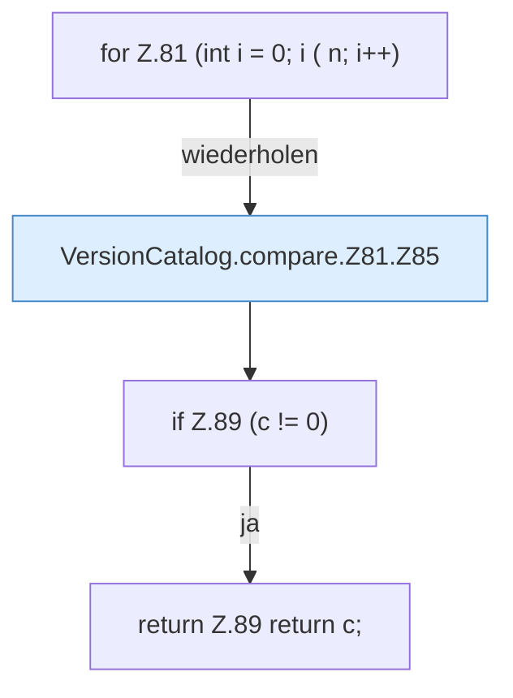

[[00 Start]] › [[Server-Anlage]] › [[Versionen]] › [[VersionCatalog]] › [[VersionCatalog.compare]] › [[VersionCatalog.compare.Z81]]

# VersionCatalog.compare.Z81



```knoten
for Z.81 (int i = 0; i ( n; i++)
  Zeile 81: Schleife `(int i = 0; i ( n; i++)`.
VersionCatalog.compare.Z81.Z85
  Der Ablauf geht in [[Glossar#Zeile|Zeile]] 85 weiter. Eine Ebene tiefer steht er genauer. Fortsetzung des Ablaufs ab Zeile 85.
if Z.89 (c != 0)
  Zeile 89: prüft `(c != 0)`.
return Z.89 return c;
  Zeile 89: Rückgabe `return c;`.
```

> [!knoten]- Was die Blöcke tun
> - **for Z.81 (int i = 0; i ( n; i++)**: Zeile 81: Schleife `(int i = 0; i ( n; i++)`.
> - **VersionCatalog.compare.Z81.Z85**: Der Ablauf geht in [[Glossar#Zeile|Zeile]] 85 weiter. Eine Ebene tiefer steht er genauer. Fortsetzung des Ablaufs ab Zeile 85.
> - **if Z.89 (c != 0)**: Zeile 89: prüft `(c != 0)`.
> - **return Z.89 return c;**: Zeile 89: Rückgabe `return c;`.

- Der Ablauf geht in [[Glossar#Zeile|Zeile]] 81 weiter. Eine Ebene tiefer steht er genauer.
- Fortsetzung von `VersionCatalog.compare`.
