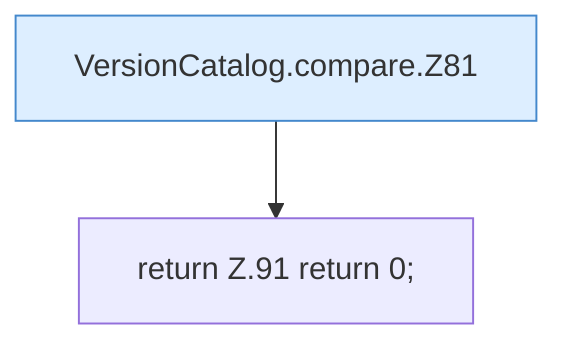

[[00 Start]] › [[Server-Anlage]] › [[Versionen]] › [[VersionCatalog]] › [[VersionCatalog.compare]]

# VersionCatalog.compare

`VersionCatalog.compare(String a, String b)` [src/main/java/de/aichele/childlauncher/VersionCatalog.java:77–92](https://github.com/Sciddie/minecraft-serverhoster-plugin/blob/95b02b953b0b4c23673e900e021a7c3c844aa37d/src/main/java/de/aichele/childlauncher/VersionCatalog.java#L77-L92)



```knoten
VersionCatalog.compare.Z81
  Fortsetzung des Ablaufs ab Zeile 81.
return Z.91 return 0;
  Zeile 91: Rückgabe `return 0;`.
```

- `compare` in `src/main/java/de/aichele/childlauncher/VersionCatalog.java`
