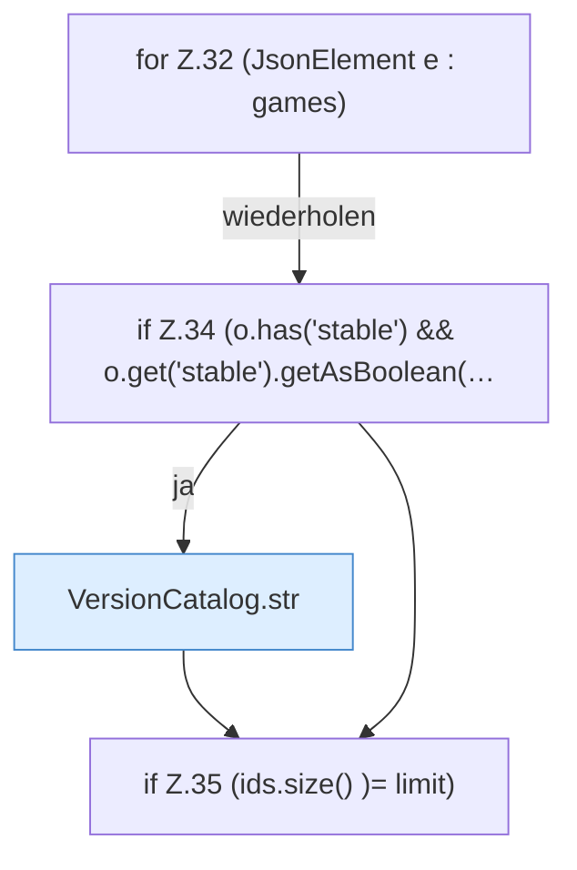

[[00 Start]] › [[Server-Anlage]] › [[Versionen]] › [[VersionCatalog]] › [[VersionCatalog.fabric]] › [[VersionCatalog.fabric.Z32]]

# VersionCatalog.fabric.Z32

- Fortsetzung von `VersionCatalog.fabric`, Quellreihenfolge.
