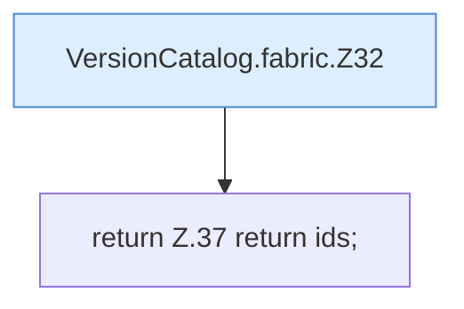

[[00 Start]] › [[Server-Anlage]] › [[Versionen]] › [[VersionCatalog]] › [[VersionCatalog.fabric]]

# VersionCatalog.fabric

`VersionCatalog.fabric(JsonArray games, int limit)` [src/main/java/de/aichele/childlauncher/VersionCatalog.java:30–38](https://github.com/Sciddie/minecraft-serverhoster-plugin/blob/95b02b953b0b4c23673e900e021a7c3c844aa37d/src/main/java/de/aichele/childlauncher/VersionCatalog.java#L30-L38)



```knoten
VersionCatalog.fabric.Z32
  Der Ablauf geht in [[Glossar#Zeile|Zeile]] 32 weiter. Eine Ebene tiefer steht er genauer. Fortsetzung des Ablaufs ab Zeile 32.
return Z.37 return ids;
  Zeile 37: Rückgabe `return ids;`.
```

> [!knoten]- Was die Blöcke tun
> - **VersionCatalog.fabric.Z32**: Der Ablauf geht in [[Glossar#Zeile|Zeile]] 32 weiter. Eine Ebene tiefer steht er genauer. Fortsetzung des Ablaufs ab Zeile 32.
> - **return Z.37 return ids;**: Zeile 37: Rückgabe `return ids;`.

- Dieser Teil macht hier einen einzelnen Schritt. Eine Ebene tiefer steht er genauer.
- `fabric` in `src/main/java/de/aichele/childlauncher/VersionCatalog.java`
