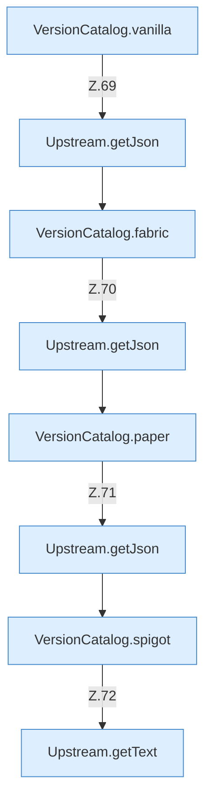

[[00 Start]] › [[Server-Anlage]] › [[Versionen]] › [[VersionCatalog]] › [[VersionCatalog.fetch]] › [[VersionCatalog.fetch.Z68.Teil1]]

# VersionCatalog.fetch.Z68.Teil1



```knoten
VersionCatalog.vanilla
  Dieser Teil macht hier einen einzelnen Schritt. Eine Ebene tiefer steht er genauer. `vanilla` in `VersionCatalog.java`. Ruft `str`.
Upstream.getJson
  Dieser Teil liefert die Antwort. Liefert `getJson`.
VersionCatalog.fabric
  Dieser Teil macht hier einen einzelnen Schritt. Eine Ebene tiefer steht er genauer. `fabric` in `VersionCatalog.java`. Ruft `str`.
VersionCatalog.paper
  Dieser Teil macht hier einen einzelnen Schritt. Eine Ebene tiefer steht er genauer. `paper` in `VersionCatalog.java`.
VersionCatalog.spigot
  Dieser Teil macht hier einen einzelnen Schritt. Eine Ebene tiefer steht er genauer. `spigot` in `VersionCatalog.java`. Ruft `compare`.
Upstream.getText
  Dieser Teil liefert den Text. Liefert `getText`.
```

> [!knoten]- Was die Blöcke tun
> - **VersionCatalog.vanilla**: Dieser Teil macht hier einen einzelnen Schritt. Eine Ebene tiefer steht er genauer. `vanilla` in `VersionCatalog.java`. Ruft `str`.
> - **Upstream.getJson**: Dieser Teil liefert die Antwort. Liefert `getJson`.
> - **VersionCatalog.fabric**: Dieser Teil macht hier einen einzelnen Schritt. Eine Ebene tiefer steht er genauer. `fabric` in `VersionCatalog.java`. Ruft `str`.
> - **VersionCatalog.paper**: Dieser Teil macht hier einen einzelnen Schritt. Eine Ebene tiefer steht er genauer. `paper` in `VersionCatalog.java`.
> - **VersionCatalog.spigot**: Dieser Teil macht hier einen einzelnen Schritt. Eine Ebene tiefer steht er genauer. `spigot` in `VersionCatalog.java`. Ruft `compare`.
> - **Upstream.getText**: Dieser Teil liefert den Text. Liefert `getText`.

- Ein weiterer Abschnitt derselben Übersicht.
- Fortsetzung von `VersionCatalog.fetch.Z68`.
