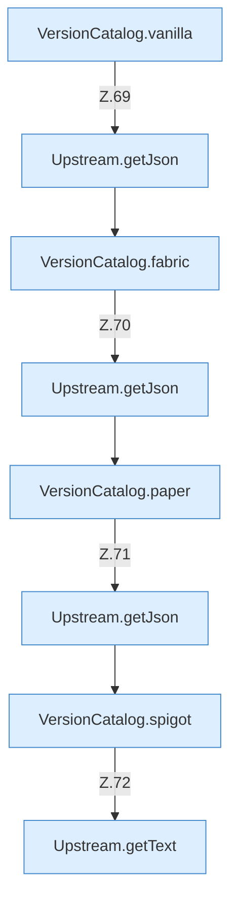

[[00 Start]] › [[Server-Anlage]] › [[Versionen]] › [[VersionCatalog]] › [[VersionCatalog.fetch]] › [[VersionCatalog.fetch.Z68.Teil1]]

# VersionCatalog.fetch.Z68.Teil1

- Fortsetzung von `VersionCatalog.fetch.Z68`, Quellreihenfolge.
