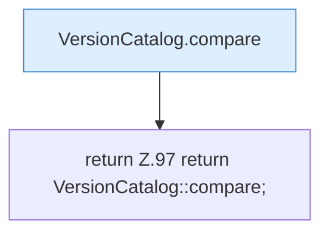

[[00 Start]] › [[Server-Anlage]] › [[Versionen]] › [[VersionCatalog]] › [[VersionCatalog.newestFirst]]

# VersionCatalog.newestFirst

`VersionCatalog.newestFirst()` [src/main/java/de/aichele/childlauncher/VersionCatalog.java:97–97](https://github.com/Sciddie/minecraft-serverhoster-plugin/blob/95b02b953b0b4c23673e900e021a7c3c844aa37d/src/main/java/de/aichele/childlauncher/VersionCatalog.java#L97-L97)



```knoten
VersionCatalog.compare
  Dieser Teil vergleicht das. Vergleicht `compare`. Ruft `num`.
return Z.97 return VersionCatalog::compare;
  Zeile 97: Rückgabe `return VersionCatalog::compare;`.
```

> [!knoten]- Was die Blöcke tun
> - **VersionCatalog.compare**: Dieser Teil vergleicht das. Vergleicht `compare`. Ruft `num`.
> - **return Z.97 return VersionCatalog::compare;**: Zeile 97: Rückgabe `return VersionCatalog::compare;`.

- Dieser Teil kümmert sich um die erste.
- `newestFirst` in `src/main/java/de/aichele/childlauncher/VersionCatalog.java`
- Befund: toter Code, sicher. src/main/java/de/aichele/childlauncher/VersionCatalog.java:97–97 kein Aufruf, kein Treffer in plugin.yml/UI/Strings
