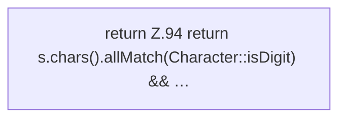

[[00 Start]] › [[Server-Anlage]] › [[Versionen]] › [[VersionCatalog]] › [[VersionCatalog.num]]

# VersionCatalog.num

`VersionCatalog.num(String s)` [src/main/java/de/aichele/childlauncher/VersionCatalog.java:94–94](https://github.com/Sciddie/minecraft-serverhoster-plugin/blob/95b02b953b0b4c23673e900e021a7c3c844aa37d/src/main/java/de/aichele/childlauncher/VersionCatalog.java#L94-L94)



```knoten
return Z.94 return s.chars().allMatch(Character::isDigit) && …
  Zeile 94: Rückgabe `return s.chars().allMatch(Character::isDigit) && …`.
```

> [!knoten]- Was die Blöcke tun
> - **return Z.94 return s.chars().allMatch(Character::isDigit) && …**: Zeile 94: Rückgabe `return s.chars().allMatch(Character::isDigit) && …`.

- Dieser Teil macht hier einen einzelnen Schritt. Eine Ebene tiefer steht er genauer.
- `num` in `src/main/java/de/aichele/childlauncher/VersionCatalog.java`
