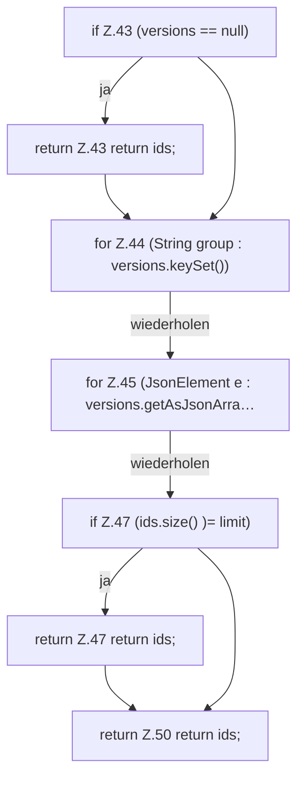

[[00 Start]] › [[Server-Anlage]] › [[Versionen]] › [[VersionCatalog]] › [[VersionCatalog.paper]]

# VersionCatalog.paper

`VersionCatalog.paper(JsonObject project, int limit)` [src/main/java/de/aichele/childlauncher/VersionCatalog.java:40–51](https://github.com/Sciddie/minecraft-serverhoster-plugin/blob/95b02b953b0b4c23673e900e021a7c3c844aa37d/src/main/java/de/aichele/childlauncher/VersionCatalog.java#L40-L51)

- `paper` in `src/main/java/de/aichele/childlauncher/VersionCatalog.java`
