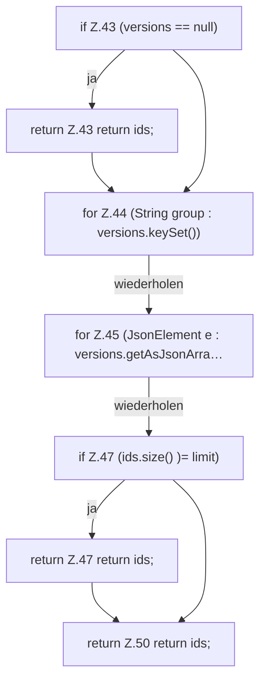

[[00 Start]] › [[Server-Anlage]] › [[Versionen]] › [[VersionCatalog]] › [[VersionCatalog.paper]]

# VersionCatalog.paper

`VersionCatalog.paper(JsonObject project, int limit)` [src/main/java/de/aichele/childlauncher/VersionCatalog.java:40–51](https://github.com/Sciddie/minecraft-serverhoster-plugin/blob/95b02b953b0b4c23673e900e021a7c3c844aa37d/src/main/java/de/aichele/childlauncher/VersionCatalog.java#L40-L51)



```knoten
if Z.43 (versions == null)
  Zeile 43: prüft `(versions == null)`.
return Z.43 return ids;
  Zeile 43: Rückgabe `return ids;`.
for Z.44 (String group : versions.keySet())
  Zeile 44: Schleife `(String group : versions.keySet())`.
for Z.45 (JsonElement e : versions.getAsJsonArra…
  Zeile 45: Schleife `(JsonElement e : versions.getAsJsonArra…`.
if Z.47 (ids.size() )= limit)
  Zeile 47: prüft `(ids.size() )= limit)`.
return Z.47 return ids;
  Zeile 47: Rückgabe `return ids;`.
return Z.50 return ids;
  Zeile 50: Rückgabe `return ids;`.
```

> [!knoten]- Was die Blöcke tun
> - **if Z.43 (versions == null)**: Zeile 43: prüft `(versions == null)`.
> - **return Z.43 return ids;**: Zeile 43: Rückgabe `return ids;`.
> - **for Z.44 (String group : versions.keySet())**: Zeile 44: Schleife `(String group : versions.keySet())`.
> - **for Z.45 (JsonElement e : versions.getAsJsonArra…**: Zeile 45: Schleife `(JsonElement e : versions.getAsJsonArra…`.
> - **if Z.47 (ids.size() )= limit)**: Zeile 47: prüft `(ids.size() )= limit)`.
> - **return Z.47 return ids;**: Zeile 47: Rückgabe `return ids;`.
> - **return Z.50 return ids;**: Zeile 50: Rückgabe `return ids;`.

- Dieser Teil macht hier einen einzelnen Schritt. Eine Ebene tiefer steht er genauer.
- `paper` in `src/main/java/de/aichele/childlauncher/VersionCatalog.java`
