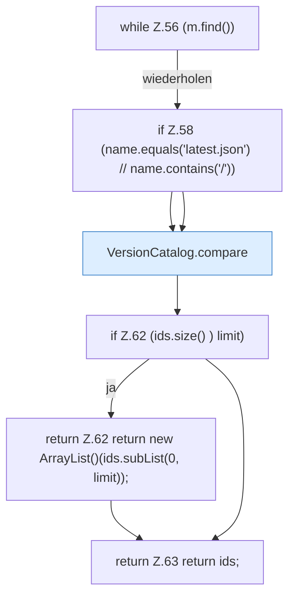

[[00 Start]] › [[Server-Anlage]] › [[Versionen]] › [[VersionCatalog]] › [[VersionCatalog.spigot]]

# VersionCatalog.spigot

`VersionCatalog.spigot(String html, int limit)` [src/main/java/de/aichele/childlauncher/VersionCatalog.java:53–64](https://github.com/Sciddie/minecraft-serverhoster-plugin/blob/95b02b953b0b4c23673e900e021a7c3c844aa37d/src/main/java/de/aichele/childlauncher/VersionCatalog.java#L53-L64)



```knoten
while Z.56 (m.find())
  Zeile 56: Schleife `(m.find())`.
if Z.58 (name.equals('latest.json') // name.contains('/'))
  Zeile 58: prüft `(name.equals('latest.json') // name.contains('/'))`.
VersionCatalog.compare
  Vergleicht `compare`. Ruft `num`.
if Z.62 (ids.size() ) limit)
  Zeile 62: prüft `(ids.size() ) limit)`.
return Z.62 return new ArrayList()(ids.subList(0, limit));
  Zeile 62: Rückgabe `return new ArrayList()(ids.subList(0, limit));`.
return Z.63 return ids;
  Zeile 63: Rückgabe `return ids;`.
```

- `spigot` in `src/main/java/de/aichele/childlauncher/VersionCatalog.java`
