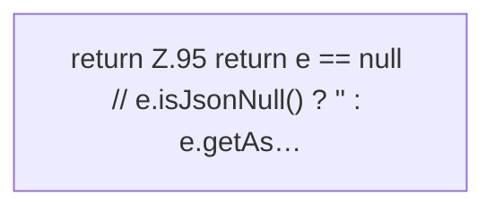

[[00 Start]] › [[Server-Anlage]] › [[Versionen]] › [[VersionCatalog]] › [[VersionCatalog.str]]

# VersionCatalog.str

`VersionCatalog.str(JsonObject o, String k)` [src/main/java/de/aichele/childlauncher/VersionCatalog.java:95–95](https://github.com/Sciddie/minecraft-serverhoster-plugin/blob/95b02b953b0b4c23673e900e021a7c3c844aa37d/src/main/java/de/aichele/childlauncher/VersionCatalog.java#L95-L95)

- `str` in `src/main/java/de/aichele/childlauncher/VersionCatalog.java`
