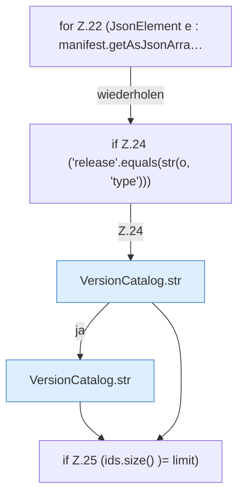

[[00 Start]] › [[Server-Anlage]] › [[Versionen]] › [[VersionCatalog]] › [[VersionCatalog.vanilla]] › [[VersionCatalog.vanilla.Z22]]

# VersionCatalog.vanilla.Z22

- Fortsetzung von `VersionCatalog.vanilla`, Quellreihenfolge.
