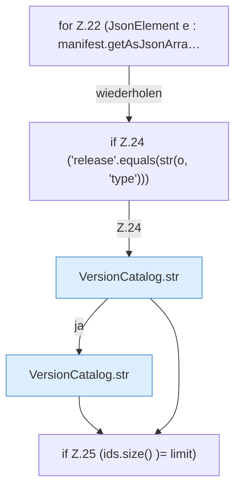

[[00 Start]] › [[Server-Anlage]] › [[Versionen]] › [[VersionCatalog]] › [[VersionCatalog.vanilla]] › [[VersionCatalog.vanilla.Z22]]

# VersionCatalog.vanilla.Z22



```knoten
for Z.22 (JsonElement e : manifest.getAsJsonArra…
  Zeile 22: Schleife `(JsonElement e : manifest.getAsJsonArra…`.
if Z.24 ('release'.equals(str(o, 'type')))
  Zeile 24: prüft `('release'.equals(str(o, 'type')))`.
VersionCatalog.str
  `str` in `VersionCatalog.java`.
if Z.25 (ids.size() )= limit)
  Zeile 25: prüft `(ids.size() )= limit)`.
```

- Fortsetzung von `VersionCatalog.vanilla`, Quellreihenfolge.
