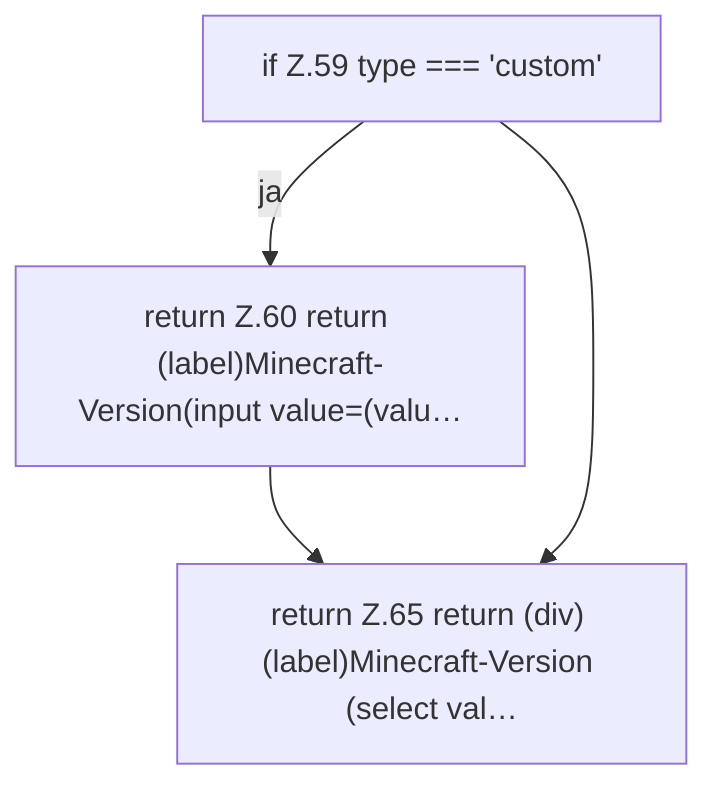

[[00 Start]] › [[Dashboard-UI]] › [[UI-Workflows]] › [[VersionSelect]] › [[VersionSelect.VersionSelect]]

# VersionSelect.VersionSelect

`VersionSelect.VersionSelect({ type, value, onChange, preserve, catalog }: {
  type: string;
  value: string;
  onChange: (value: string) => void;
  preserve: boolean;
  catalog: ReturnType<typeof useVersionCatalog>;
})` [ui/src/components/VersionSelect.tsx:45–76](https://github.com/Sciddie/minecraft-serverhoster-plugin/blob/95b02b953b0b4c23673e900e021a7c3c844aa37d/ui/src/components/VersionSelect.tsx#L45-L76)



```knoten
if Z.59 type === 'custom'
  Zeile 59: prüft `type === 'custom'`.
return Z.60 return (label)Minecraft-Version(input value=(valu…
  Zeile 60: Rückgabe `return (label)Minecraft-Version(input value=(valu…`.
return Z.65 return (div) (label)Minecraft-Version (select val…
  Zeile 65: Rückgabe `return (div) (label)Minecraft-Version (select val…`.
```

> [!knoten]- Was die Blöcke tun
> - **if Z.59 type === 'custom'**: Zeile 59: prüft `type === 'custom'`.
> - **return Z.60 return (label)Minecraft-Version(input value=(valu…**: Zeile 60: Rückgabe `return (label)Minecraft-Version(input value=(valu…`.
> - **return Z.65 return (div) (label)Minecraft-Version (select val…**: Zeile 65: Rückgabe `return (div) (label)Minecraft-Version (select val…`.

- Die [[Glossar#Bedienseite|Bedienseite]] wählt das.
- `VersionSelect` in `ui/src/components/VersionSelect.tsx`
