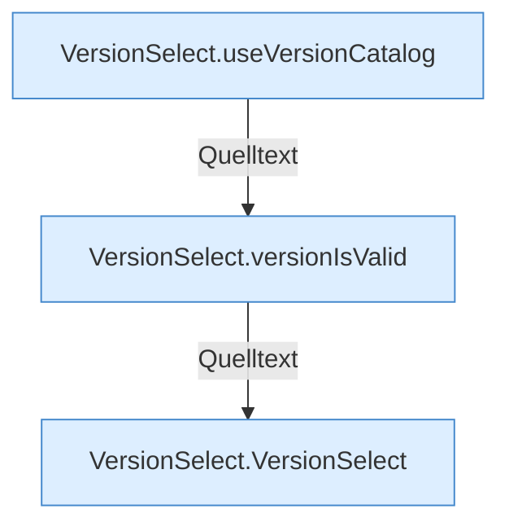

[[00 Start]] › [[Dashboard-UI]] › [[UI-Workflows]] › [[VersionSelect]]

# VersionSelect



```knoten
VersionSelect.useVersionCatalog
  Benutzt `useVersionCatalog`. Ruft `dashboardRequest`.
VersionSelect.versionIsValid
  `versionIsValid` in `VersionSelect.tsx`.
VersionSelect.VersionSelect
  `VersionSelect` in `VersionSelect.tsx`.
```


