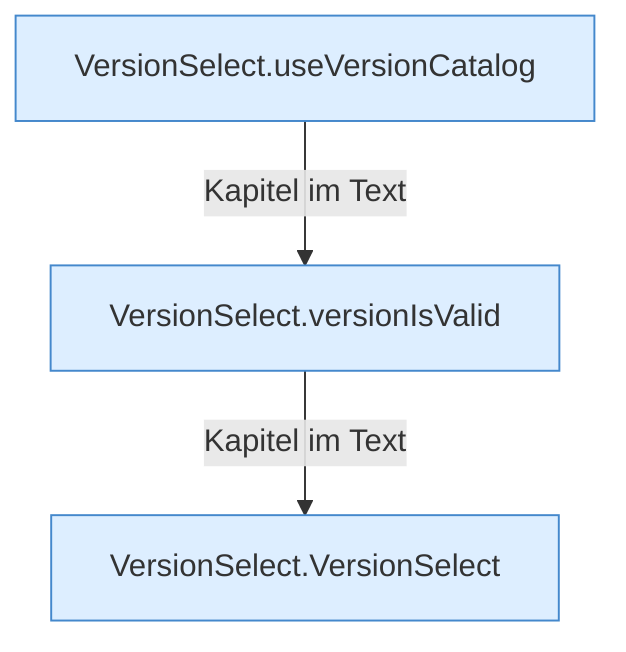

[[00 Start]] › [[Dashboard-UI]] › [[UI-Workflows]] › [[VersionSelect]]

# VersionSelect



```knoten
VersionSelect.useVersionCatalog
  Die [[Glossar#Bedienseite|Bedienseite]] kümmert sich um die [[Glossar#Version|Version]] die Versionsliste. Im [[Glossar#Quelltext|Quelltext]] heißt das `useVersionCatalog`.
VersionSelect.versionIsValid
  Die [[Glossar#Bedienseite|Bedienseite]] prüft hier einen Schritt. Eine Ebene tiefer steht er genauer. Im [[Glossar#Quelltext|Quelltext]] heißt das `versionIsValid`.
VersionSelect.VersionSelect
  Die [[Glossar#Bedienseite|Bedienseite]] wählt das. Im [[Glossar#Quelltext|Quelltext]] heißt das `VersionSelect`.
```

> [!knoten]- Was die Blöcke tun
> - **VersionSelect.useVersionCatalog**: Die [[Glossar#Bedienseite|Bedienseite]] kümmert sich um die [[Glossar#Version|Version]] die Versionsliste. Im [[Glossar#Quelltext|Quelltext]] heißt das `useVersionCatalog`.
> - **VersionSelect.versionIsValid**: Die [[Glossar#Bedienseite|Bedienseite]] prüft hier einen Schritt. Eine Ebene tiefer steht er genauer. Im [[Glossar#Quelltext|Quelltext]] heißt das `versionIsValid`.
> - **VersionSelect.VersionSelect**: Die [[Glossar#Bedienseite|Bedienseite]] wählt das. Im [[Glossar#Quelltext|Quelltext]] heißt das `VersionSelect`.

- Die Auswahl der [[Glossar#Version|Version]] in der [[Glossar#Bedienseite|Bedienseite]].
