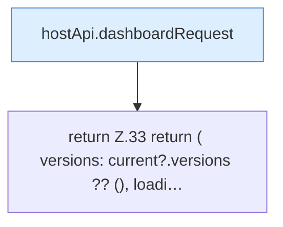

[[00 Start]] › [[Dashboard-UI]] › [[UI-Workflows]] › [[VersionSelect]] › [[VersionSelect.useVersionCatalog]]

# VersionSelect.useVersionCatalog

`VersionSelect.useVersionCatalog(type: string, enabled: boolean)` [ui/src/components/VersionSelect.tsx:6–39](https://github.com/Sciddie/minecraft-serverhoster-plugin/blob/95b02b953b0b4c23673e900e021a7c3c844aa37d/ui/src/components/VersionSelect.tsx#L6-L39)



```knoten
hostApi.dashboardRequest
  Schickt von der [[Glossar#Bedienseite|Bedienseite]] eine Anfrage an das [[Glossar#Plugin|Plugin]]. `dashboardRequest` in `hostApi.ts`.
return Z.33 return ( versions: current?.versions ?? (), loadi…
  Zeile 33: Rückgabe `return ( versions: current?.versions ?? (), loadi…`.
```

> [!knoten]- Was die Blöcke tun
> - **hostApi.dashboardRequest**: Schickt von der [[Glossar#Bedienseite|Bedienseite]] eine Anfrage an das [[Glossar#Plugin|Plugin]]. `dashboardRequest` in `hostApi.ts`.
> - **return Z.33 return ( versions: current?.versions ?? (), loadi…**: Zeile 33: Rückgabe `return ( versions: current?.versions ?? (), loadi…`.

- Die [[Glossar#Bedienseite|Bedienseite]] kümmert sich um die [[Glossar#Version|Version]] die Versionsliste.
- `useVersionCatalog` in `ui/src/components/VersionSelect.tsx`
