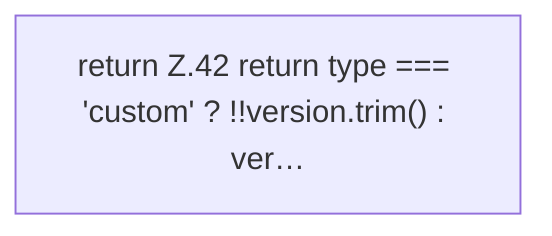

[[00 Start]] › [[Dashboard-UI]] › [[UI-Workflows]] › [[VersionSelect]] › [[VersionSelect.versionIsValid]]

# VersionSelect.versionIsValid

`VersionSelect.versionIsValid(type: string, version: string, versions: string[], preserve: boolean)` [ui/src/components/VersionSelect.tsx:41–43](https://github.com/Sciddie/minecraft-serverhoster-plugin/blob/95b02b953b0b4c23673e900e021a7c3c844aa37d/ui/src/components/VersionSelect.tsx#L41-L43)



```knoten
return Z.42 return type === 'custom' ? !!version.trim() : ver…
  Zeile 42: Rückgabe `return type === 'custom' ? !!version.trim() : ver…`.
```

> [!knoten]- Was die Blöcke tun
> - **return Z.42 return type === 'custom' ? !!version.trim() : ver…**: Zeile 42: Rückgabe `return type === 'custom' ? !!version.trim() : ver…`.

- Die [[Glossar#Bedienseite|Bedienseite]] prüft hier einen Schritt. Eine Ebene tiefer steht er genauer.
- `versionIsValid` in `ui/src/components/VersionSelect.tsx`
