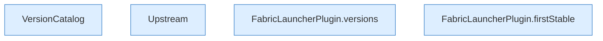

[[00 Start]] › [[Server-Anlage]] › [[Versionen]]

# Versionen



```knoten
VersionCatalog
  Holt die Liste der [[Glossar#Version|Versionen]] aus dem Netz und vergleicht sie.
Upstream
  Die Quelle im Netz, von der die Versionslisten kommen.
FabricLauncherPlugin.versions
  Liefert die bekannten [[Glossar#Version|Versionen]].
FabricLauncherPlugin.firstStable
  Sucht die neueste [[Glossar#Version|Version]], die als stabil gilt.
```

> [!knoten] Was die Blöcke tun
> - **VersionCatalog**: Holt die Liste der [[Glossar#Version|Versionen]] aus dem Netz und vergleicht sie.
> - **Upstream**: Die Quelle im Netz, von der die Versionslisten kommen.
> - **FabricLauncherPlugin.versions**: Liefert die bekannten [[Glossar#Version|Versionen]].
> - **FabricLauncherPlugin.firstStable**: Sucht die neueste [[Glossar#Version|Version]], die als stabil gilt.

- Welche [[Glossar#Version|Versionen]] es gibt und welche das [[Glossar#Plugin|Plugin]] als stabil nimmt.
