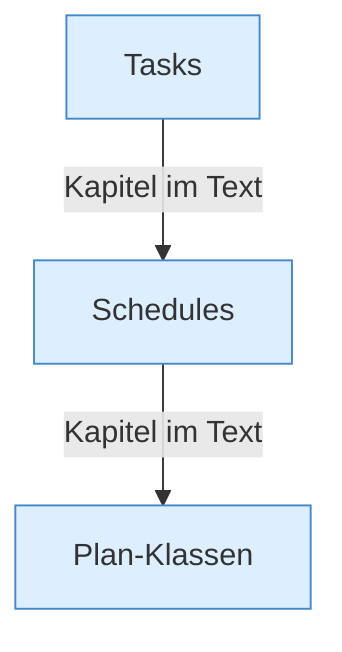

[[00 Start]] › [[Zeitplaene]]

# Zeitplaene



```knoten
Tasks
  Die ältere Aufgabenliste. Ein [[Glossar#Wecker|Wecker]] sieht alle zwanzig Sekunden nach, ob etwas fällig ist. In den [[Glossar#Einstellungen|Einstellungen]] gilt die Liste als veraltet.
Schedules
  Die Zeitpläne. Ein [[Glossar#Wecker|Wecker]] sieht alle zwanzig Sekunden nach, ob einer fällig ist.
Plan-Klassen
  Die Bausteine eines [[Glossar#Zeitplan|Zeitplans]]: die Beschreibung, die Ausführung, die Uhrzeitregel und die Übernahme alter [[Glossar#Aufgabe|Aufgaben]].
```

> [!knoten] Was die Blöcke tun
> - **Tasks**: Die ältere Aufgabenliste. Ein [[Glossar#Wecker|Wecker]] sieht alle zwanzig Sekunden nach, ob etwas fällig ist. In den [[Glossar#Einstellungen|Einstellungen]] gilt die Liste als veraltet.
> - **Schedules**: Die Zeitpläne. Ein [[Glossar#Wecker|Wecker]] sieht alle zwanzig Sekunden nach, ob einer fällig ist.
> - **Plan-Klassen**: Die Bausteine eines [[Glossar#Zeitplan|Zeitplans]]: die Beschreibung, die Ausführung, die Uhrzeitregel und die Übernahme alter [[Glossar#Aufgabe|Aufgaben]].

- Zeitpläne und daneben die ältere Aufgabenliste. Beide werden regelmäßig angeschaut. Die alte Liste ist eine [[Glossar#Altlast|Altlast]].
- Auffällig: ein alter Weg läuft noch mit. Das nennt man [[Glossar#Altlast|Altlast]].
