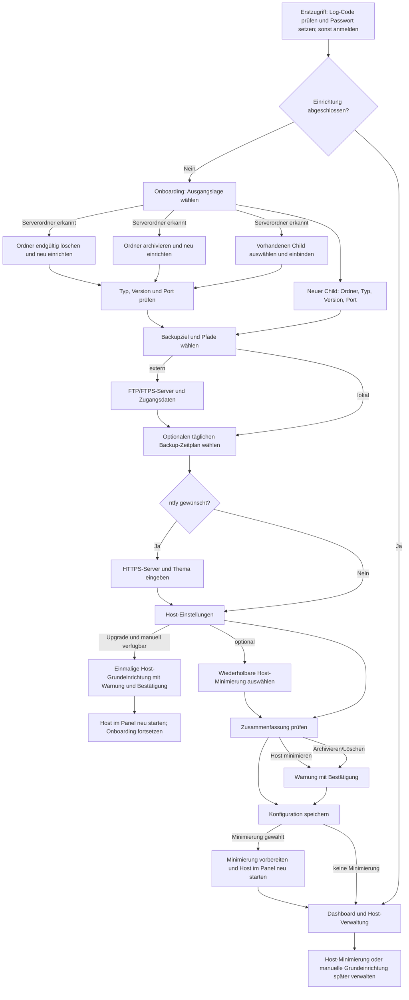

# Einrichtungswege und Entscheidungen

Bei einer Neuinstallation erfolgt die einmalige Host-Grundeinrichtung vor
dem ersten Dashboard-Aufruf automatisch. Bei Upgrades kann sie nur ausdrücklich
ausgelöst werden; erkannte alte Hostwelten werden dabei unwiderruflich gelöscht.
Ein Neustart muss im Hosting-Panel durchgeführt werden. Wird die Einrichtung
während des Onboardings ausgelöst, gehen noch nicht gespeicherte Eingaben verloren.

Der Assistent lädt keine Server-JARs herunter und startet den Child nicht.
RAM, JVM-Flags, weitere Backup-Zeitpläne und Child-`server.properties` können nach der
Einrichtung im Dashboard angepasst werden; sie sind keine Voraussetzung für
die Auswahl eines der bestehenden Einrichtungswege.
