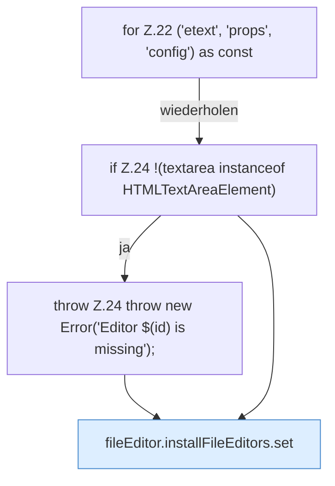

[[00 Start]] › [[Dashboard-UI]] › [[UI-Client]] › [[fileEditor.installFileEditors]] › [[fileEditor.installFileEditors.Z22]]

# fileEditor.installFileEditors.Z22

- Fortsetzung von `fileEditor.installFileEditors`, Quellreihenfolge.
