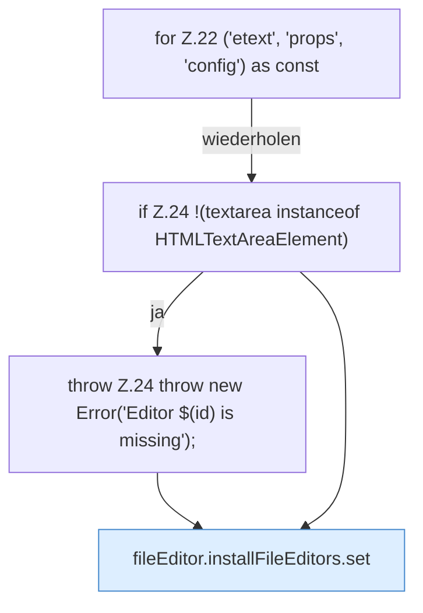

[[00 Start]] › [[Dashboard-UI]] › [[UI-Client]] › [[fileEditor.installFileEditors]] › [[fileEditor.installFileEditors.Z22]]

# fileEditor.installFileEditors.Z22



```knoten
for Z.22 ('etext', 'props', 'config') as const
  Zeile 22: Schleife `('etext', 'props', 'config') as const`.
if Z.24 !(textarea instanceof HTMLTextAreaElement)
  Zeile 24: prüft `!(textarea instanceof HTMLTextAreaElement)`.
throw Z.24 throw new Error('Editor $(id) is missing');
  Zeile 24: Abbruch `throw new Error('Editor $(id) is missing');`.
fileEditor.installFileEditors.set
  Die [[Glossar#Bedienseite|Bedienseite]] setzt das. Setzt `set`. Ruft `editorFor`, `modeForPath`, `refresh`.
```

> [!knoten]- Was die Blöcke tun
> - **for Z.22 ('etext', 'props', 'config') as const**: Zeile 22: Schleife `('etext', 'props', 'config') as const`.
> - **if Z.24 !(textarea instanceof HTMLTextAreaElement)**: Zeile 24: prüft `!(textarea instanceof HTMLTextAreaElement)`.
> - **throw Z.24 throw new Error('Editor $(id) is missing');**: Zeile 24: Abbruch `throw new Error('Editor $(id) is missing');`.
> - **fileEditor.installFileEditors.set**: Die [[Glossar#Bedienseite|Bedienseite]] setzt das. Setzt `set`. Ruft `editorFor`, `modeForPath`, `refresh`.

- Der Ablauf geht in [[Glossar#Zeile|Zeile]] 22 weiter. Eine Ebene tiefer steht er genauer.
- Fortsetzung von `fileEditor.installFileEditors`.
