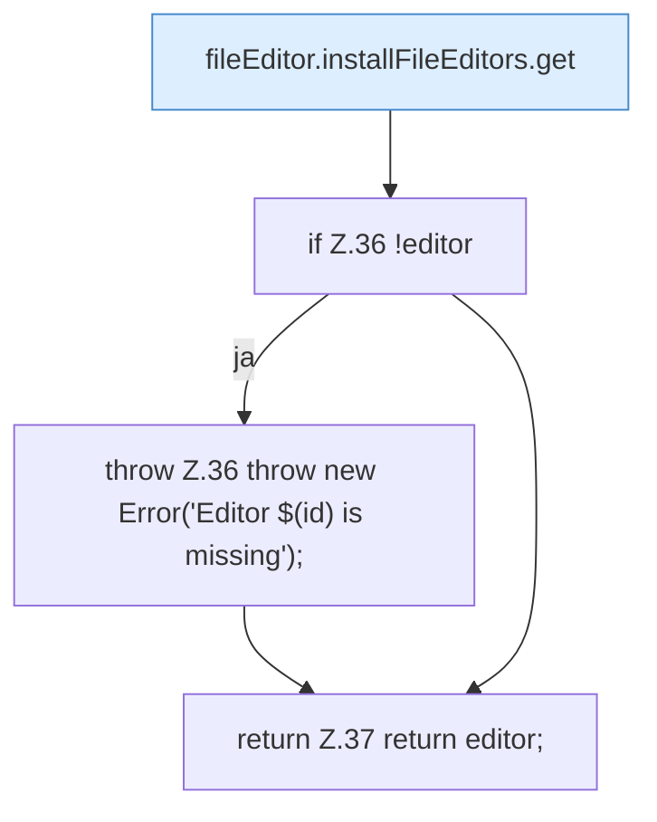

[[00 Start]] › [[Dashboard-UI]] › [[UI-Client]] › [[fileEditor.installFileEditors]] › [[fileEditor.installFileEditors.editorFor]]

# fileEditor.installFileEditors.editorFor

`fileEditor.editorFor(id: EditorId)` [ui/src/lib/fileEditor.ts:34–38](https://github.com/Sciddie/minecraft-serverhoster-plugin/blob/95b02b953b0b4c23673e900e021a7c3c844aa37d/ui/src/lib/fileEditor.ts#L34-L38)



```knoten
fileEditor.installFileEditors.get
  Liefert `get`. Ruft `editorFor`.
if Z.36 !editor
  Zeile 36: prüft `!editor`.
throw Z.36 throw new Error('Editor $(id) is missing');
  Zeile 36: Abbruch `throw new Error('Editor $(id) is missing');`.
return Z.37 return editor;
  Zeile 37: Rückgabe `return editor;`.
```

- `editorFor` in `ui/src/lib/fileEditor.ts`
