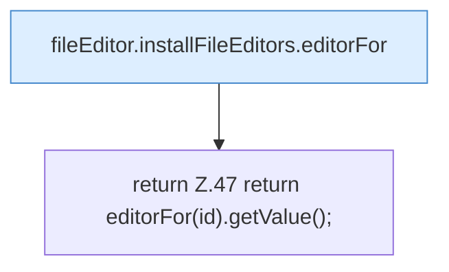

[[00 Start]] › [[Dashboard-UI]] › [[UI-Client]] › [[fileEditor.installFileEditors]] › [[fileEditor.installFileEditors.get]]

# fileEditor.installFileEditors.get

`fileEditor.get(id: EditorId)` [ui/src/lib/fileEditor.ts:47–47](https://github.com/Sciddie/minecraft-serverhoster-plugin/blob/95b02b953b0b4c23673e900e021a7c3c844aa37d/ui/src/lib/fileEditor.ts#L47-L47)

- `get` in `ui/src/lib/fileEditor.ts`
