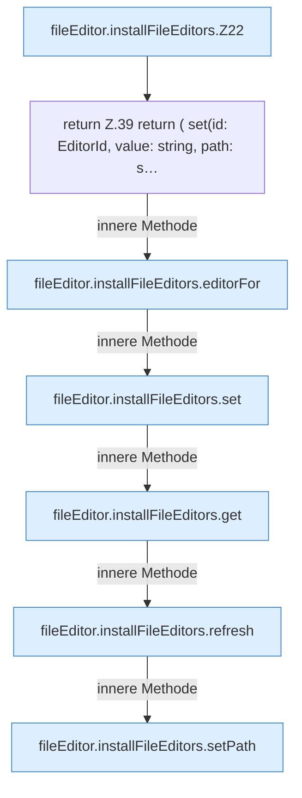

[[00 Start]] › [[Dashboard-UI]] › [[UI-Client]] › [[fileEditor.installFileEditors]]

# fileEditor.installFileEditors

`fileEditor.installFileEditors()` [ui/src/lib/fileEditor.ts:20–51](https://github.com/Sciddie/minecraft-serverhoster-plugin/blob/95b02b953b0b4c23673e900e021a7c3c844aa37d/ui/src/lib/fileEditor.ts#L20-L51)



```knoten
fileEditor.installFileEditors.Z22
  Der Ablauf geht in [[Glossar#Zeile|Zeile]] 22 weiter. Eine Ebene tiefer steht er genauer. Im [[Glossar#Quelltext|Quelltext]] heißt das `Z22`.
return Z.39 return ( set(id: EditorId, value: string, path: s…
  Hier endet die [[Glossar#Funktion|Funktion]] und liefert ein Ergebnis zurück. Das steht in [[Glossar#Zeile|Zeile]] 39.
fileEditor.installFileEditors.editorFor
  Die [[Glossar#Bedienseite|Bedienseite]] kümmert sich um für. Im [[Glossar#Quelltext|Quelltext]] heißt das `editorFor`.
fileEditor.installFileEditors.set
  Die [[Glossar#Bedienseite|Bedienseite]] setzt das. Im [[Glossar#Quelltext|Quelltext]] heißt das `set`.
fileEditor.installFileEditors.get
  Die [[Glossar#Bedienseite|Bedienseite]] liefert das. Im [[Glossar#Quelltext|Quelltext]] heißt das `get`.
fileEditor.installFileEditors.refresh
  Die [[Glossar#Bedienseite|Bedienseite]] lädt neu das. Im [[Glossar#Quelltext|Quelltext]] heißt das `refresh`.
fileEditor.installFileEditors.setPath
  Die [[Glossar#Bedienseite|Bedienseite]] setzt den Pfad. Im [[Glossar#Quelltext|Quelltext]] heißt das `setPath`.
```

> [!knoten]- Was die Blöcke tun
> - **fileEditor.installFileEditors.Z22**: Der Ablauf geht in [[Glossar#Zeile|Zeile]] 22 weiter. Eine Ebene tiefer steht er genauer. Im [[Glossar#Quelltext|Quelltext]] heißt das `Z22`.
> - **return Z.39 return ( set(id: EditorId, value: string, path: s…**: Hier endet die [[Glossar#Funktion|Funktion]] und liefert ein Ergebnis zurück. Das steht in [[Glossar#Zeile|Zeile]] 39.
> - **fileEditor.installFileEditors.editorFor**: Die [[Glossar#Bedienseite|Bedienseite]] kümmert sich um für. Im [[Glossar#Quelltext|Quelltext]] heißt das `editorFor`.
> - **fileEditor.installFileEditors.set**: Die [[Glossar#Bedienseite|Bedienseite]] setzt das. Im [[Glossar#Quelltext|Quelltext]] heißt das `set`.
> - **fileEditor.installFileEditors.get**: Die [[Glossar#Bedienseite|Bedienseite]] liefert das. Im [[Glossar#Quelltext|Quelltext]] heißt das `get`.
> - **fileEditor.installFileEditors.refresh**: Die [[Glossar#Bedienseite|Bedienseite]] lädt neu das. Im [[Glossar#Quelltext|Quelltext]] heißt das `refresh`.
> - **fileEditor.installFileEditors.setPath**: Die [[Glossar#Bedienseite|Bedienseite]] setzt den Pfad. Im [[Glossar#Quelltext|Quelltext]] heißt das `setPath`.

- Die [[Glossar#Bedienseite|Bedienseite]] richtet ein die Datei die Editoren.
