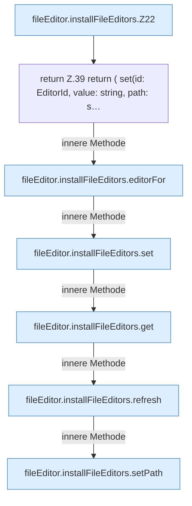

[[00 Start]] › [[Dashboard-UI]] › [[UI-Client]] › [[fileEditor.installFileEditors]]

# fileEditor.installFileEditors

`fileEditor.installFileEditors()` [ui/src/lib/fileEditor.ts:20–51](https://github.com/Sciddie/minecraft-serverhoster-plugin/blob/95b02b953b0b4c23673e900e021a7c3c844aa37d/ui/src/lib/fileEditor.ts#L20-L51)

- `installFileEditors` in `ui/src/lib/fileEditor.ts`
