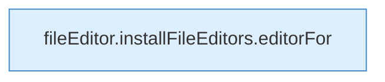

[[00 Start]] › [[Dashboard-UI]] › [[UI-Client]] › [[fileEditor.installFileEditors]] › [[fileEditor.installFileEditors.refresh]]

# fileEditor.installFileEditors.refresh

`fileEditor.refresh(id: EditorId)` [ui/src/lib/fileEditor.ts:48–48](https://github.com/Sciddie/minecraft-serverhoster-plugin/blob/95b02b953b0b4c23673e900e021a7c3c844aa37d/ui/src/lib/fileEditor.ts#L48-L48)



```knoten
fileEditor.installFileEditors.editorFor
  Die [[Glossar#Bedienseite|Bedienseite]] kümmert sich um für. Liefert den Editor `editorFor`. Ruft `get`.
```

> [!knoten]- Was die Blöcke tun
> - **fileEditor.installFileEditors.editorFor**: Die [[Glossar#Bedienseite|Bedienseite]] kümmert sich um für. Liefert den Editor `editorFor`. Ruft `get`.

- Die [[Glossar#Bedienseite|Bedienseite]] lädt neu das.
- `refresh` in `ui/src/lib/fileEditor.ts`
