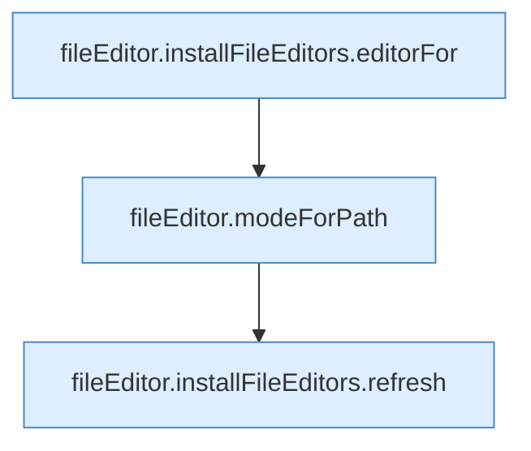

[[00 Start]] › [[Dashboard-UI]] › [[UI-Client]] › [[fileEditor.installFileEditors]] › [[fileEditor.installFileEditors.set]]

# fileEditor.installFileEditors.set

`fileEditor.set(id: EditorId, value: string, path: string)` [ui/src/lib/fileEditor.ts:40–46](https://github.com/Sciddie/minecraft-serverhoster-plugin/blob/95b02b953b0b4c23673e900e021a7c3c844aa37d/ui/src/lib/fileEditor.ts#L40-L46)



```knoten
fileEditor.installFileEditors.editorFor
  Liefert den Editor `editorFor`. Ruft `get`.
fileEditor.modeForPath
  `modeForPath` in `fileEditor.ts`.
fileEditor.installFileEditors.refresh
  Lädt neu `refresh`. Ruft `editorFor`.
```

- `set` in `ui/src/lib/fileEditor.ts`
