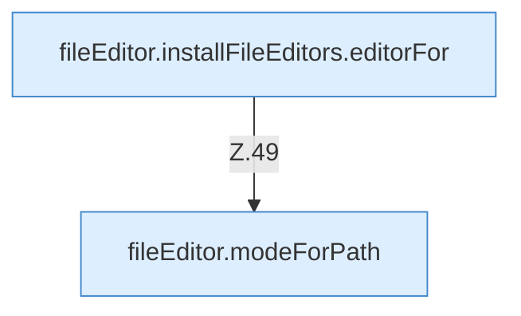

[[00 Start]] › [[Dashboard-UI]] › [[UI-Client]] › [[fileEditor.installFileEditors]] › [[fileEditor.installFileEditors.setPath]]

# fileEditor.installFileEditors.setPath

`fileEditor.setPath(id: EditorId, path: string)` [ui/src/lib/fileEditor.ts:49–49](https://github.com/Sciddie/minecraft-serverhoster-plugin/blob/95b02b953b0b4c23673e900e021a7c3c844aa37d/ui/src/lib/fileEditor.ts#L49-L49)



```knoten
fileEditor.installFileEditors.editorFor
  Die [[Glossar#Bedienseite|Bedienseite]] kümmert sich um für. Liefert den Editor `editorFor`. Ruft `get`.
fileEditor.modeForPath
  Wählt, wie eine Datei in der [[Glossar#Bedienseite|Bedienseite]] bearbeitet wird, je nach Art der Datei. `modeForPath` in `fileEditor.ts`.
```

> [!knoten]- Was die Blöcke tun
> - **fileEditor.installFileEditors.editorFor**: Die [[Glossar#Bedienseite|Bedienseite]] kümmert sich um für. Liefert den Editor `editorFor`. Ruft `get`.
> - **fileEditor.modeForPath**: Wählt, wie eine Datei in der [[Glossar#Bedienseite|Bedienseite]] bearbeitet wird, je nach Art der Datei. `modeForPath` in `fileEditor.ts`.

- Die [[Glossar#Bedienseite|Bedienseite]] setzt den Pfad.
- `setPath` in `ui/src/lib/fileEditor.ts`
