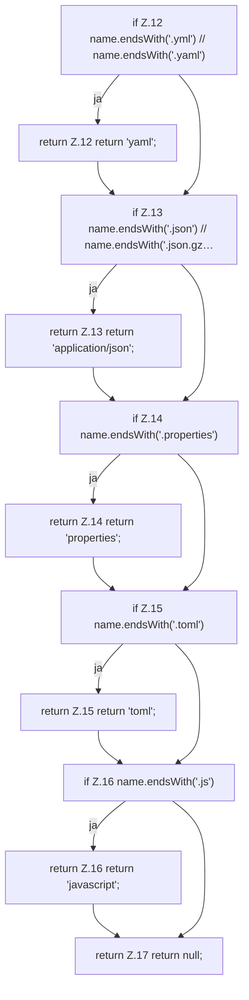

[[00 Start]] › [[Dashboard-UI]] › [[UI-Client]] › [[fileEditor.modeForPath]]

# fileEditor.modeForPath

`fileEditor.modeForPath(path: string)` [ui/src/lib/fileEditor.ts:10–18](https://github.com/Sciddie/minecraft-serverhoster-plugin/blob/95b02b953b0b4c23673e900e021a7c3c844aa37d/ui/src/lib/fileEditor.ts#L10-L18)



```knoten
if Z.12 name.endsWith('.yml') // name.endsWith('.yaml')
  Zeile 12: prüft `name.endsWith('.yml') // name.endsWith('.yaml')`.
return Z.12 return 'yaml';
  Zeile 12: Rückgabe `return 'yaml';`.
if Z.13 name.endsWith('.json') // name.endsWith('.json.gz…
  Zeile 13: prüft `name.endsWith('.json') // name.endsWith('.json.gz…`.
return Z.13 return 'application/json';
  Zeile 13: Rückgabe `return 'application/json';`.
if Z.14 name.endsWith('.properties')
  Zeile 14: prüft `name.endsWith('.properties')`.
return Z.14 return 'properties';
  Zeile 14: Rückgabe `return 'properties';`.
if Z.15 name.endsWith('.toml')
  Zeile 15: prüft `name.endsWith('.toml')`.
return Z.15 return 'toml';
  Zeile 15: Rückgabe `return 'toml';`.
if Z.16 name.endsWith('.js')
  Zeile 16: prüft `name.endsWith('.js')`.
return Z.16 return 'javascript';
  Zeile 16: Rückgabe `return 'javascript';`.
return Z.17 return null;
  Zeile 17: Rückgabe `return null;`.
```

- `modeForPath` in `ui/src/lib/fileEditor.ts`
