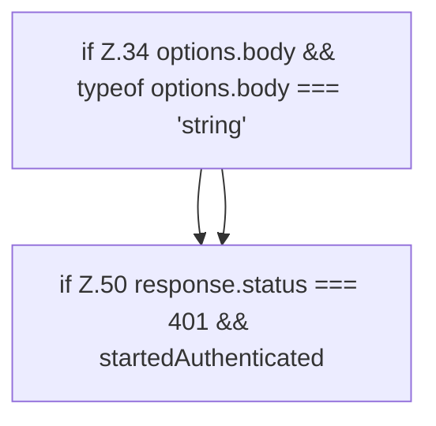

[[00 Start]] › [[Dashboard-UI]] › [[UI-Client]] › [[hostApi.dashboardRequest]] › [[hostApi.dashboardRequest.Teil1]]

# hostApi.dashboardRequest.Teil1

- Fortsetzung von `hostApi.dashboardRequest`, Quellreihenfolge.
