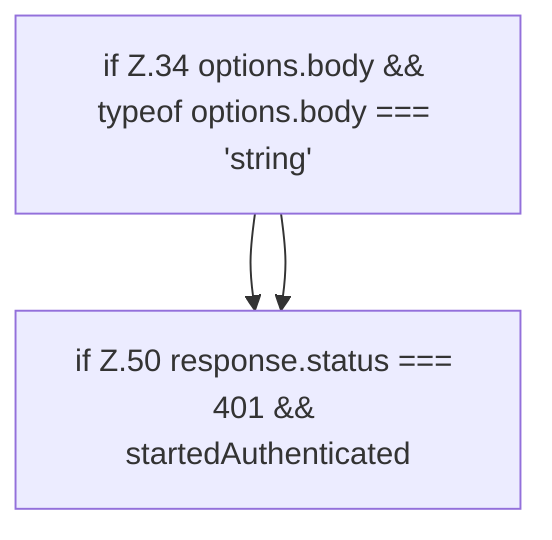

[[00 Start]] › [[Dashboard-UI]] › [[UI-Client]] › [[hostApi.dashboardRequest]] › [[hostApi.dashboardRequest.Teil1]]

# hostApi.dashboardRequest.Teil1



```knoten
if Z.34 options.body && typeof options.body === 'string'
  Zeile 34: prüft `options.body && typeof options.body === 'string'`.
if Z.50 response.status === 401 && startedAuthenticated
  Zeile 50: prüft `response.status === 401 && startedAuthenticated`.
```

> [!knoten]- Was die Blöcke tun
> - **if Z.34 options.body && typeof options.body === 'string'**: Zeile 34: prüft `options.body && typeof options.body === 'string'`.
> - **if Z.50 response.status === 401 && startedAuthenticated**: Zeile 50: prüft `response.status === 401 && startedAuthenticated`.

- Ein weiterer Abschnitt derselben Übersicht.
- Fortsetzung von `hostApi.dashboardRequest`.
