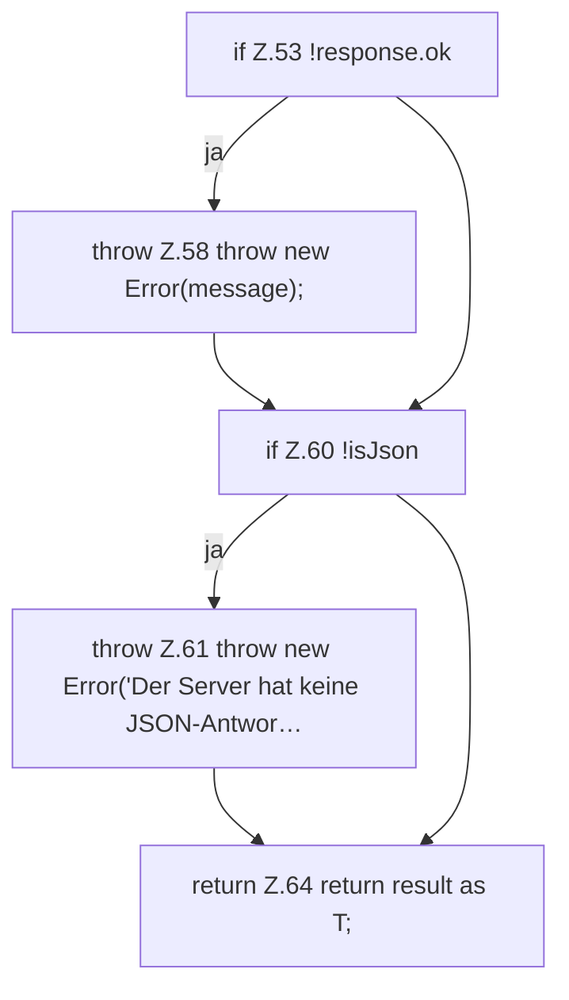

[[00 Start]] › [[Dashboard-UI]] › [[UI-Client]] › [[hostApi.dashboardRequest]] › [[hostApi.dashboardRequest.Teil2]]

# hostApi.dashboardRequest.Teil2



```knoten
if Z.53 !response.ok
  Zeile 53: prüft `!response.ok`.
throw Z.58 throw new Error(message);
  Zeile 58: Abbruch `throw new Error(message);`.
if Z.60 !isJson
  Zeile 60: prüft `!isJson`.
throw Z.61 throw new Error('Der Server hat keine JSON-Antwor…
  Zeile 61: Abbruch `throw new Error('Der Server hat keine JSON-Antwor…`.
return Z.64 return result as T;
  Zeile 64: Rückgabe `return result as T;`.
```

> [!knoten]- Was die Blöcke tun
> - **if Z.53 !response.ok**: Zeile 53: prüft `!response.ok`.
> - **throw Z.58 throw new Error(message);**: Zeile 58: Abbruch `throw new Error(message);`.
> - **if Z.60 !isJson**: Zeile 60: prüft `!isJson`.
> - **throw Z.61 throw new Error('Der Server hat keine JSON-Antwor…**: Zeile 61: Abbruch `throw new Error('Der Server hat keine JSON-Antwor…`.
> - **return Z.64 return result as T;**: Zeile 64: Rückgabe `return result as T;`.

- Ein weiterer Abschnitt derselben Übersicht.
- Fortsetzung von `hostApi.dashboardRequest`.
