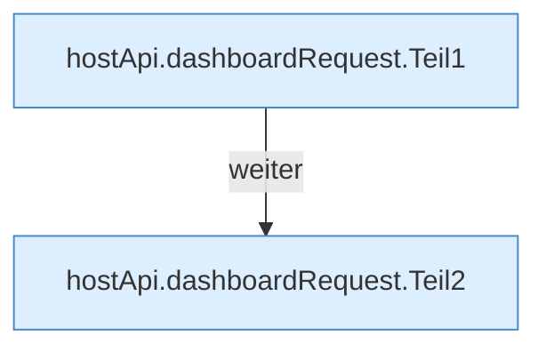

[[00 Start]] › [[Dashboard-UI]] › [[UI-Client]] › [[hostApi.dashboardRequest]]

# hostApi.dashboardRequest

`hostApi.dashboardRequest(path: string, options: RequestInit = {})` [ui/src/lib/hostApi.ts:28–65](https://github.com/Sciddie/minecraft-serverhoster-plugin/blob/95b02b953b0b4c23673e900e021a7c3c844aa37d/ui/src/lib/hostApi.ts#L28-L65)



```knoten
hostApi.dashboardRequest.Teil1
  Ein weiterer Abschnitt derselben Übersicht. Im [[Glossar#Quelltext|Quelltext]] heißt das `Teil1`.
hostApi.dashboardRequest.Teil2
  Ein weiterer Abschnitt derselben Übersicht. Im [[Glossar#Quelltext|Quelltext]] heißt das `Teil2`.
```

> [!knoten]- Was die Blöcke tun
> - **hostApi.dashboardRequest.Teil1**: Ein weiterer Abschnitt derselben Übersicht. Im [[Glossar#Quelltext|Quelltext]] heißt das `Teil1`.
> - **hostApi.dashboardRequest.Teil2**: Ein weiterer Abschnitt derselben Übersicht. Im [[Glossar#Quelltext|Quelltext]] heißt das `Teil2`.

- Schickt von der [[Glossar#Bedienseite|Bedienseite]] eine Anfrage an das [[Glossar#Plugin|Plugin]].
