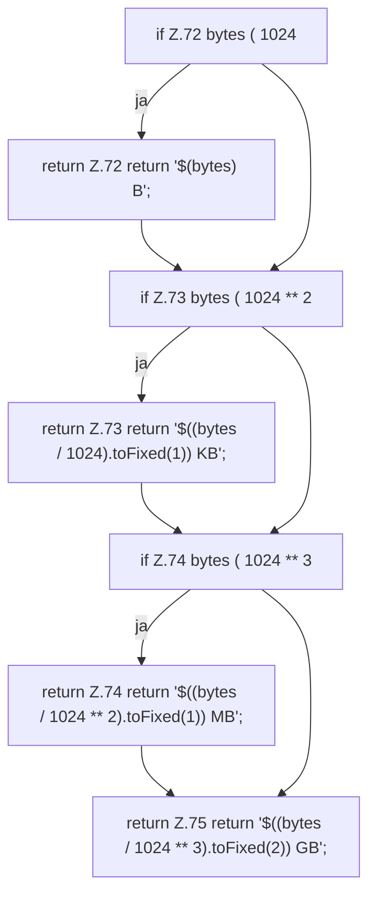

[[00 Start]] › [[Dashboard-UI]] › [[UI-Client]] › [[hostApi.formatBytes]]

# hostApi.formatBytes

`hostApi.formatBytes(bytes: number)` [ui/src/lib/hostApi.ts:71–76](https://github.com/Sciddie/minecraft-serverhoster-plugin/blob/95b02b953b0b4c23673e900e021a7c3c844aa37d/ui/src/lib/hostApi.ts#L71-L76)



```knoten
if Z.72 bytes ( 1024
  Zeile 72: prüft `bytes ( 1024`.
return Z.72 return '$(bytes) B';
  Zeile 72: Rückgabe `return '$(bytes) B';`.
if Z.73 bytes ( 1024 ** 2
  Zeile 73: prüft `bytes ( 1024 ** 2`.
return Z.73 return '$((bytes / 1024).toFixed(1)) KB';
  Zeile 73: Rückgabe `return '$((bytes / 1024).toFixed(1)) KB';`.
if Z.74 bytes ( 1024 ** 3
  Zeile 74: prüft `bytes ( 1024 ** 3`.
return Z.74 return '$((bytes / 1024 ** 2).toFixed(1)) MB';
  Zeile 74: Rückgabe `return '$((bytes / 1024 ** 2).toFixed(1)) MB';`.
return Z.75 return '$((bytes / 1024 ** 3).toFixed(2)) GB';
  Zeile 75: Rückgabe `return '$((bytes / 1024 ** 3).toFixed(2)) GB';`.
```

- `formatBytes` in `ui/src/lib/hostApi.ts`
