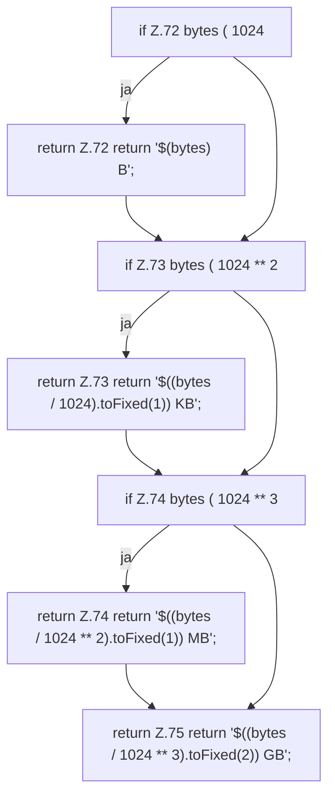

[[00 Start]] › [[Dashboard-UI]] › [[UI-Client]] › [[hostApi.formatBytes]]

# hostApi.formatBytes

`hostApi.formatBytes(bytes: number)` [ui/src/lib/hostApi.ts:71–76](https://github.com/Sciddie/minecraft-serverhoster-plugin/blob/95b02b953b0b4c23673e900e021a7c3c844aa37d/ui/src/lib/hostApi.ts#L71-L76)



```knoten
if Z.72 bytes ( 1024
  Hier fällt eine Entscheidung. Nur wenn sie zutrifft, geht es den Ja-Weg weiter. Das steht in [[Glossar#Zeile|Zeile]] 72.
return Z.72 return '$(bytes) B';
  Hier endet die [[Glossar#Funktion|Funktion]] und liefert ein Ergebnis zurück. Das steht in [[Glossar#Zeile|Zeile]] 72.
if Z.73 bytes ( 1024 ** 2
  Hier fällt eine Entscheidung. Nur wenn sie zutrifft, geht es den Ja-Weg weiter. Das steht in [[Glossar#Zeile|Zeile]] 73.
return Z.73 return '$((bytes / 1024).toFixed(1)) KB';
  Hier endet die [[Glossar#Funktion|Funktion]] und liefert ein Ergebnis zurück. Das steht in [[Glossar#Zeile|Zeile]] 73.
if Z.74 bytes ( 1024 ** 3
  Hier fällt eine Entscheidung. Nur wenn sie zutrifft, geht es den Ja-Weg weiter. Das steht in [[Glossar#Zeile|Zeile]] 74.
return Z.74 return '$((bytes / 1024 ** 2).toFixed(1)) MB';
  Hier endet die [[Glossar#Funktion|Funktion]] und liefert ein Ergebnis zurück. Das steht in [[Glossar#Zeile|Zeile]] 74.
return Z.75 return '$((bytes / 1024 ** 3).toFixed(2)) GB';
  Hier endet die [[Glossar#Funktion|Funktion]] und liefert ein Ergebnis zurück. Das steht in [[Glossar#Zeile|Zeile]] 75.
```

> [!knoten]- Was die Blöcke tun
> - **if Z.72 bytes ( 1024**: Hier fällt eine Entscheidung. Nur wenn sie zutrifft, geht es den Ja-Weg weiter. Das steht in [[Glossar#Zeile|Zeile]] 72.
> - **return Z.72 return '$(bytes) B';**: Hier endet die [[Glossar#Funktion|Funktion]] und liefert ein Ergebnis zurück. Das steht in [[Glossar#Zeile|Zeile]] 72.
> - **if Z.73 bytes ( 1024 ** 2**: Hier fällt eine Entscheidung. Nur wenn sie zutrifft, geht es den Ja-Weg weiter. Das steht in [[Glossar#Zeile|Zeile]] 73.
> - **return Z.73 return '$((bytes / 1024).toFixed(1)) KB';**: Hier endet die [[Glossar#Funktion|Funktion]] und liefert ein Ergebnis zurück. Das steht in [[Glossar#Zeile|Zeile]] 73.
> - **if Z.74 bytes ( 1024 ** 3**: Hier fällt eine Entscheidung. Nur wenn sie zutrifft, geht es den Ja-Weg weiter. Das steht in [[Glossar#Zeile|Zeile]] 74.
> - **return Z.74 return '$((bytes / 1024 ** 2).toFixed(1)) MB';**: Hier endet die [[Glossar#Funktion|Funktion]] und liefert ein Ergebnis zurück. Das steht in [[Glossar#Zeile|Zeile]] 74.
> - **return Z.75 return '$((bytes / 1024 ** 3).toFixed(2)) GB';**: Hier endet die [[Glossar#Funktion|Funktion]] und liefert ein Ergebnis zurück. Das steht in [[Glossar#Zeile|Zeile]] 75.

- Die [[Glossar#Bedienseite|Bedienseite]] macht lesbar die Größe.
