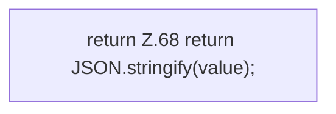

[[00 Start]] › [[Dashboard-UI]] › [[UI-Client]] › [[hostApi.jsonBody]]

# hostApi.jsonBody

`hostApi.jsonBody(value: unknown)` [ui/src/lib/hostApi.ts:67–69](https://github.com/Sciddie/minecraft-serverhoster-plugin/blob/95b02b953b0b4c23673e900e021a7c3c844aa37d/ui/src/lib/hostApi.ts#L67-L69)



```knoten
return Z.68 return JSON.stringify(value);
  Hier endet die [[Glossar#Funktion|Funktion]] und liefert ein Ergebnis zurück. Das steht in [[Glossar#Zeile|Zeile]] 68.
```

> [!knoten]- Was die Blöcke tun
> - **return Z.68 return JSON.stringify(value);**: Hier endet die [[Glossar#Funktion|Funktion]] und liefert ein Ergebnis zurück. Das steht in [[Glossar#Zeile|Zeile]] 68.

- Baut den Text, den die [[Glossar#Bedienseite|Bedienseite]] als Auftrag mitschickt.
