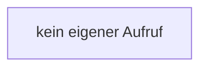

[[00 Start]] › [[Dashboard-UI]] › [[Legacy-Sitzung]] › [[index.$]]

# index.$

`index.$(id)` [src/main/resources/web/index.html:71–71](https://github.com/Sciddie/minecraft-serverhoster-plugin/blob/95b02b953b0b4c23673e900e021a7c3c844aa37d/src/main/resources/web/index.html#L71-L71)



```knoten
kein eigener Aufruf
  Dieser Abschnitt ruft keine weitere eigene [[Glossar#Funktion|Funktion]] auf.
```

> [!knoten]- Was die Blöcke tun
> - **kein eigener Aufruf**: Dieser Abschnitt ruft keine weitere eigene [[Glossar#Funktion|Funktion]] auf.

- Sucht auf der älteren [[Glossar#Bedienseite|Bedienseite]] ein einzelnes Element.
