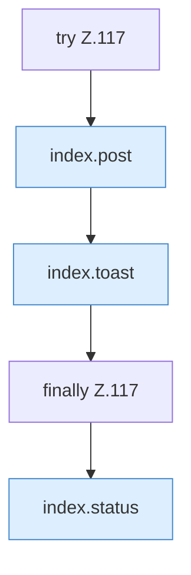

[[00 Start]] › [[Dashboard-UI]] › [[Legacy-Status]] › [[index.act]] › [[index.act.Z117]]

# index.act.Z117



```knoten
try Z.117
  Zeile 117: Versuch. Der Fehlerpfad geht in catch.
index.post
  Sendet POST `post`. Ruft `api`.
index.toast
  Zeigt eine Meldung `toast`. Ruft `$`.
finally Z.117
  Läuft danach immer, auch nach einem Fehler.
index.status
  Liefert den Status `status`. Ruft `api`, `updateChildActions`, `$`.
```

- Fortsetzung von `index.act`, Quellreihenfolge.
