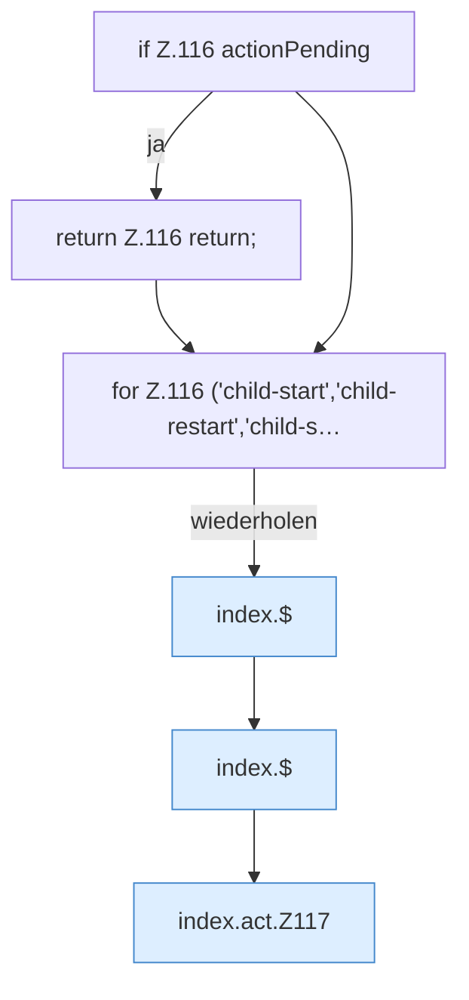

[[00 Start]] › [[Dashboard-UI]] › [[Legacy-Status]] › [[index.act]]

# index.act

`index.act(a)` [src/main/resources/web/index.html:116–118](https://github.com/Sciddie/minecraft-serverhoster-plugin/blob/95b02b953b0b4c23673e900e021a7c3c844aa37d/src/main/resources/web/index.html#L116-L118)



```knoten
if Z.116 actionPending
  Hier fällt eine Entscheidung. Nur wenn sie zutrifft, geht es den Ja-Weg weiter. Das steht in [[Glossar#Zeile|Zeile]] 116.
return Z.116 return;
  Hier endet die [[Glossar#Funktion|Funktion]] und liefert ein Ergebnis zurück. Das steht in [[Glossar#Zeile|Zeile]] 116.
for Z.116 ('child-start','child-restart','child-s…
  Dasselbe wird für jeden Eintrag wiederholt. Das steht in [[Glossar#Zeile|Zeile]] 116.
index.$
  Sucht auf der älteren [[Glossar#Bedienseite|Bedienseite]] ein einzelnes Element. Im [[Glossar#Quelltext|Quelltext]] heißt das `$`.
index.act.Z117
  Der Ablauf geht in [[Glossar#Zeile|Zeile]] 117 weiter. Eine Ebene tiefer steht er genauer. Im [[Glossar#Quelltext|Quelltext]] heißt das `Z117`.
```

> [!knoten]- Was die Blöcke tun
> - **if Z.116 actionPending**: Hier fällt eine Entscheidung. Nur wenn sie zutrifft, geht es den Ja-Weg weiter. Das steht in [[Glossar#Zeile|Zeile]] 116.
> - **return Z.116 return;**: Hier endet die [[Glossar#Funktion|Funktion]] und liefert ein Ergebnis zurück. Das steht in [[Glossar#Zeile|Zeile]] 116.
> - **for Z.116 ('child-start','child-restart','child-s…**: Dasselbe wird für jeden Eintrag wiederholt. Das steht in [[Glossar#Zeile|Zeile]] 116.
> - **index.$**: Sucht auf der älteren [[Glossar#Bedienseite|Bedienseite]] ein einzelnes Element. Im [[Glossar#Quelltext|Quelltext]] heißt das `$`.
> - **index.act.Z117**: Der Ablauf geht in [[Glossar#Zeile|Zeile]] 117 weiter. Eine Ebene tiefer steht er genauer. Im [[Glossar#Quelltext|Quelltext]] heißt das `Z117`.

- Schickt von der älteren [[Glossar#Bedienseite|Bedienseite]] Start, [[Glossar#Stopp|Stopp]] oder [[Glossar#Neustart|Neustart]].
